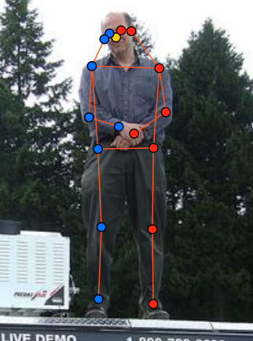
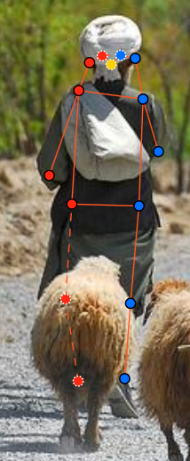
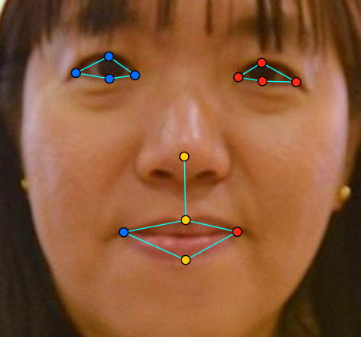
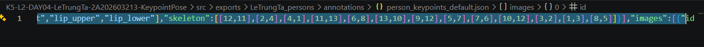

# Báo cáo cá nhân — HoVaTen-MSSV

Đổi tên file theo quy tắc `MSSV_HoTen.md`. Ví dụ: `20241234_NguyenVanAn.md`.

Dữ liệu: 12 ảnh người COCO val2017 (Lin et al., 2014) và 8 ảnh chân dung Wikimedia Commons, chỉ dùng trong lớp.

## 0. Thông tin học viên

- Họ tên: Lê Trung Tá
- MSSV: 2A202603213
- Email: taikhoan0125@gmail.com
- Link repository: https://github.com/trugta/K5-L2-DAY04-LeTrungTa-2A202603213-KeypointPose.git
- Phiên bản CVAT (Help → About):
- Máy: hệ điều hành win 11 · RAM 8 GB · chạy CVAT chế độ lite
- Bộ ảnh (`src/exports/assignment.json` do `lab.py setup` tạo): có
- Giờ bắt đầu: 4 giờ 30
- Giờ kết thúc: 6 giờ 40

## 1. Kiểm tra label (CP0)

| Label | Kiểu | Số điểm | Tên điểm đúng bảng của lab? | Đúng thứ tự? | Số cạnh |
|---|---|---:|---|---|---:|
| `person` | Skeleton | 17 | có | có | 19 |
| `face` | Skeleton | 13 | có | có | 9 |

Mẫu `person` dựng theo người quay mặt về camera (các điểm `left_*` nằm bên phải khung mẫu)? Có

Cách đổi cờ `occluded` / `outside` cho **một điểm** trên phiên bản CVAT này (một câu): Sử dụng phím tắt [O] hoặc [Q].

...

## 2. Số lượng đã gán và thời gian (CP1, CP2)

| Nhóm ảnh | Số ảnh | Số skeleton đã gán | Số người dưới 60 px (không gán) | Số poster / gương / màn hình bỏ qua | Thời gian (phút) |
|---|---:|---:|---:|---:|---:|
| `easy` | 5 | 7 | 0 | 1 | 20 |
| `occluded` | 3 | 0 | 0 | | 5 |
| `back` | 3 | 5 | 3 | 0 | 5 |
| `small` | 1 | 2 | 3 | 3 | 5 |
| `crowd` | 1 | 3 | 3 | 3 | 5 |
| `faces` | 8 | 8 | 0 | 0 | 20 |

- Số ảnh người đã xong ở mốc phút 105: 10 / 10
- Thời gian thực tế (phút): CP1 40 · CP2 30 · CP3 20
- Ảnh tốn thời gian nhất là ảnh nào, vì sao? ảnh tốn thời gian nhất là ảnh có đối tượng quay lưng ở sát góc bên trái, đối tượng có kích thước rất nhỏ đồng thời ở sát rìa ảnh nên khó để gán nhãn

...

## 3. Bảng ca khó (CP1, CP2)

Mỗi điểm bạn phân vân một dòng, nhất là phân vân giữa `v = 1` và `v = 0`, hoặc không chắc hướng người.

| Ảnh | Người / mặt | Điểm | Cờ đã chọn | Phân vân giữa | Lý do chọn |
|---|---|---|---:|---|---|
| 000000167027.jpg | người | 16 | `v = 0` | `v = 1` và `v = 0` | không thể nhận biết được điểm bị che |
| 000000078170.jpg | người | 17 | `v = 0` | `v = 1` và `v = 0` | không thể nhận biết được điểm bị che |
| 000000078170.jpg | người | 16 và 17 | `v = 1` | `v = 1` và `v = 0` | điểm không nằm ngoài ảnh nhưng vẫn nhận biết được |

## 4. Bảng tự review (CP3)

Đi từ ảnh cuối về ảnh đầu. 5 ảnh người (ít nhất 2 ảnh `back` hoặc `crowd`) và 3 ảnh mặt. Ít nhất 8 dòng, kể cả dòng `ok`. Ghi lỗi trước, sửa sau.

Mã lỗi dùng đúng một trong: `lr_swap`, `vis_flag`, `position`, `missing`, `extra`, `ok`.

| Ảnh | Người / mặt | Điểm | Mã lỗi | Ghi chú | Đã sửa? |
|---|---|---|---|---|---|
| 000000515309.jpg | người | 1,2,3 | lr_swap | | có |
| 000000480582.jpg | người | 1,2,3 | lr_swap | | có |
| 000000326480.jpg | người | 9,11 | position | | có |
| 000000167027.jpg | người | 8,10 | missing |  | có |
| 000000078170.jpg | người | 16,17 | vis_flag |  | có |
| face_185015.jpg | mặt | | ok | | |
| face_204787.jpg | mặt | | ok | | |
| face_261458.jpg | mặt | | ok | | |

Tổng hợp số lỗi theo mã:

| `lr_swap` | `vis_flag` | `position` | `missing` | `extra` | `ok` |
|---:|---:|---:|---:|---:|---:|
| 2 | 1 | 1 | 1 | 0 | 3 |

Điểm còn phân vân giữa `v = 1` và `v = 0` (ghi cả hai lựa chọn và lý do chọn):

...

## 5. Kiểm file xuất và kết quả tự kiểm (CP4)

Tự kiểm tay trong file JSON:

| File | Người / mặt kiểm (ảnh, thứ tự) | Số phần tử `keypoints` | Điểm `outside` ra `v = 0`, `occluded` ra `v = 1`? | `num_keypoints` khớp? |
|---|---|---:|---|---|
| `LeTrungTa_persons.zip` | 000000078170.jpg, người thứ 2 (id = 4) | 51 | Có. Hai mắt cá chân có v = 0. Tai phải, hai khuỷu tay và gối trái có v = 1. | 15 |
| `LeTrungTa_persons.zip` | 000000167027.jpg, người thứ 1 (id = 5) | 51 | Có. Vai, khuỷu tay, cổ tay, gối và mắt cá chân bên trái có v = 0. Mũi và hai mắt có v = 1. | 12 |
| `LeTrungTa_faces.zip` | face_185015.jpg, mặt thứ 1 (id = 1) | 39 | Không | 13 |

Sau khi xuất, CVAT ghi `occluded` thành `v = 1` và `outside` thành `v = 2`. Tọa độ của điểm `outside` trong file là `0, 0` hay tọa độ cũ? tọa độ cũ

Hai job đã chuyển sang completed trên CVAT? Có

Dán phần **TÓM TẮT** in ra từ `src/check_submission.py`:

```text
- File person: LeTrungTa_persons.zip
  Số ảnh: 12 · số skeleton `person`: 19 · mỗi annotation 51 số
  Skeleton theo ảnh: 000000019754=1, 000000021235=1, 000000078170=2, 000000167027=2, 000000189365=2, 000000295358=1, 000000326480=3, 000000336477=1, 000000431893=1, 000000467300=2, 000000480582=2, 000000515309=1
  Cờ v: v=2 233 (72%) · v=1 63 (20%) · v=0 27 (8%)
  num_keypoints trung bình: 15.6
- Ghi chú: 27 điểm v = 0 vẫn mang tọa độ cũ (CVAT 2.x xuất như vậy; chuẩn COCO ghi 0, 0). Không phải lỗi: điểm v = 0 bị bỏ qua khi huấn luyện và khi chấm.
- Số [LỖI]: 0 · số [CẢNH BÁO]: 3
Kết quả: ĐẠT (đọc lại từng cảnh báo ở trên)

- File face: LeTrungTa_faces.zip
  Số ảnh: 8 · số skeleton `face`: 8 · mỗi annotation 39 số
  Skeleton theo ảnh: face_185015=1, face_204787=1, face_261458=1, face_294580=1, face_300399=1, face_38721=1, face_449454=1, face_81239=1
  Cờ v: v=2 104 (100%) · v=1 0 (0%) · v=0 0 (0%)
  num_keypoints trung bình: 13.0
- Số [LỖI]: 0 · số [CẢNH BÁO]: 0
Kết quả: ĐẠT
```

Các `[CẢNH BÁO]` còn giữ nguyên và lý do:

...

## 6. Ảnh chụp màn hình

1. Label `person` trong label constructor (đủ 17 điểm có tên):

   

2. Một người quay lưng đã gán, cờ đã đặt:

   

3. Một khuôn mặt đã gán 13 điểm, phóng to vùng mắt:

   

4. Một đoạn JSON xuất của một người:

   

Nguồn ảnh: COCO val2017 / Wikimedia Commons.

## 7. Tự đánh giá

1. Lỗi bạn mắc nhiều nhất hôm nay, và cách bạn sẽ tránh ở dự án thật:

   ...

2. Một quy tắc bạn đề xuất thêm vào guideline (kèm ảnh ví dụ nếu có):

   ...

3. Nhãn của bạn đi vào model ở đâu? Chọn một lỗi bạn đã sửa và nói nó sẽ làm model học sai thế nào (heatmap, trọng số trong loss, hay bước lật ảnh):

   ...

## 8. Khó khăn và lỗi kỹ thuật

...

## Bonus (nếu làm)

### B1 — 3 ảnh người khó thêm

| Ảnh | Số skeleton | Số người dưới 60 px | Ca khó nhất |
|---|---:|---:|---|
| 000000213506.jpg | 3 | 0 | Skeleton #1 ở phía trên ảnh. Cả 6 điểm ở hông, gối và cổ chân đều được đánh dấu outside. |
| 000000323525.jpg | 3 | 0 | Skeleton #5 ở bên phải. Cả 5 điểm trên mặt và 3 điểm ở tay được đánh dấu outside, còn gối trái và cổ chân trái bị che. |
| 000000565600.jpg | 3 | 0 | Skeleton #7 ở bên phải ảnh. Cả 5 điểm trên mặt được đánh dấu outside, còn gối phải và hai cổ chân bị che. |

Kết quả `src/check_submission.py` cho `HoVaTen_bonus_persons.zip`:

```text
=== src\exports\LeTrungTa_bonus_persons.zip (label `person`) ===
  [CẢNH BÁO] 000000213506.jpg #2: cặp ear nằm ngược phía so với các cặp còn lại. Có thể đổi trái/phải một cặp (`lr_swap`), hoặc tay / chân bắt chéo thật: kiểm lại.
  [CẢNH BÁO] File có 3 ảnh, bài giao 12 ảnh. Xuất đúng task chưa?

----- TÓM TẮT (dán vào báo cáo mục 5) -----
- File person: LeTrungTa_bonus_persons.zip
  Số ảnh: 3 · số skeleton `person`: 9 · mỗi annotation 51 số
  Skeleton theo ảnh: 000000213506=3, 000000323525=3, 000000565600=3
  Cờ v: v=2 101 (66%) · v=1 14 (9%) · v=0 38 (25%)
  num_keypoints trung bình: 12.8
- Ghi chú: 38 điểm v = 0 vẫn mang tọa độ cũ (CVAT 2.x xuất như vậy; chuẩn COCO ghi 0, 0). Không phải lỗi: điểm v = 0 bị bỏ qua khi huấn luyện và khi chấm.
- Số [LỖI]: 0 · số [CẢNH BÁO]: 2
Kết quả: ĐẠT (đọc lại từng cảnh báo ở trên)
```

### B2 — 5 ảnh khuôn mặt đen trắng / hồng ngoại

Ảnh không màu khó hơn ở điểm nào? Kính râm trên ảnh hồng ngoại có còn là `v = 1` không?

Ảnh không màu khó gán nhãn hơn khi da, gọng kính và vùng bóng có mức xám gần nhau, Kính râm trên ảnh hồng ngoại vẫn được gán v = 1 nếu tròng hoặc gọng kính che điểm cần đánh dấu và mình phải ước lượng vị trí.

### B3 — Model so với nhãn của tôi (không tính điểm)

- Demo đã dùng:
- Ảnh đã thử:

1. Model có trả điểm cho khớp bị che, hay khớp ngoài ảnh không? Confidence ở các điểm đó thế nào?

   Model có thể vẫn dự đoán tọa độ cho khớp bị che dựa vào tư thế. Với khớp ngoài ảnh, kết quả phụ thuộc vào model và cách xử lý đầu ra

2. Với người quay lưng, model có đổi trái/phải không?

   Trái/phải được xác định theo cơ thể người trong ảnh. Khi người đó quay lưng, vai trái thường nằm bên trái ảnh. Nếu model gán left_shoulder vào vai phải của người đó thì model đã nhầm trái/phải.

3. Bộ điểm của model có giống 17 điểm COCO không?

   Bộ nhãn trong file person có đúng 17 điểm COCO

## 9. Tài liệu tham khảo và công cụ AI đã dùng

...
